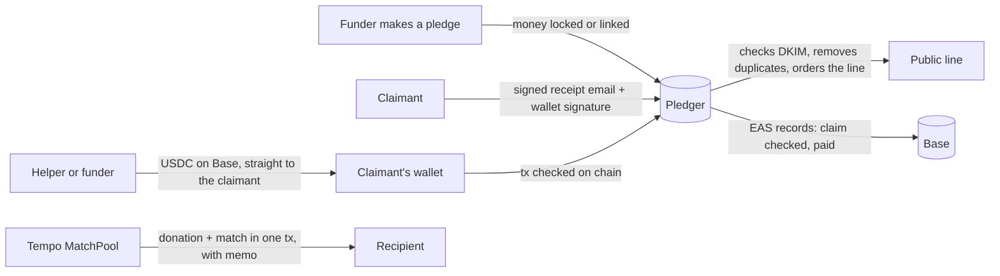
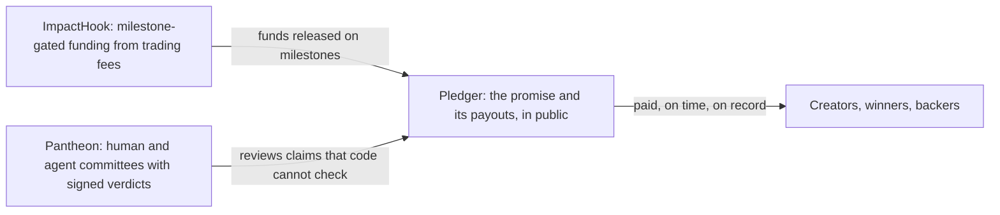

# Pledger

Pledges you can trust.

When someone promises money (a match, a prize, a give-back), Pledger shows whether the money is really there and when it will land. The person pledging sets the rule once. Pledger checks claims, keeps the public list and records every payment. It never holds anyone's money.

Live: **https://pledger.impacthook.org**

Built for Colosseum's Crypto World's Fair (Sep 14 to Oct 12, 2026). Started Oct 11, 2026. Chains: Tempo (match pools), Base (claims, payouts and public records) and Zcash (testnet, private pledges).

## What you can try

| | Where | What happens |
|---|---|---|
| Demo match pool (test money) | [/pledges/test-match-pool](https://pledger.impacthook.org/pledges/test-match-pool) | Press **Try it with test money**. The page makes a throwaway test wallet, fills it with free test money, and gives $5 to $20. The pool matches 1:1 up to $20 per visitor, in the same transaction, with no fee for the donor. The match is locked until 31 Dec 2026 and cannot be taken back before then. No login, no wallet extension. The demo also shows the whole route, from card to USDC on Tempo to a matched donation, with the card step in Stripe's sandbox. |
| Artizen give-back (real) | [/pledges/artizen-give-back](https://pledger.impacthook.org/pledges/artizen-give-back) | People who paid Artizen's 10% endowment fee in Season 7 claim it back from half of the builder's Colosseum winnings. They drop in their original receipt emails, and Pledger checks Artizen's DKIM signature on each one, so there are no screenshots and no manual review. Self-backers go first, smallest claims first. Anyone can pay people in line directly on Base, by amount or by the next people in line. |
| Zcash testnet pledge (test money) | [/pledges/zcash-private-pledge](https://pledger.impacthook.org/pledges/zcash-private-pledge) | A pledge whose funder stays private while the money stays checkable. Look at **What's in place** (0.1239 TAZ, funder private), then open **Verify it yourself**: copy the viewing key and run the command to see the same balance. Open the pledge transaction in the explorer: it shows the fee only, with no sender, recipient or amount. The key can read but cannot spend. |
| Pay by card (sandbox) | [/claim/line](https://pledger.impacthook.org/claim/line) | Pay by card: Stripe's onramp sells USDC on Base and sends it straight to the person's wallet, which Pledger locks as the destination (sandbox mode for the hackathon). |

## How it works

- **Match pools on Tempo** (`contracts/`): the sponsor deposits the match, which stays locked until a set date. Each donation is matched up to a ratio and a per-donor cap, then donation and match go to the recipient together with a receipt memo. Donors pay no fee (Tempo's fee sponsor relay).
- **Claims from email receipts** (`verify/`, `app/src/lib/verify/`): only a valid signature from artizen.fund that matches the sender counts. The fingerprint of each email can be claimed once. A creator's "You sold" email proves a purchase was self-backed, and it never adds money.
- **Payments on Base** (`app/src/lib/base.ts`): a payment counts when a native USDC transfer to the claimant appears in a successful transaction. Pay inside Pledger, paste a transaction link, or pay by card through Stripe's onramp with the claimant's wallet locked as the destination. Card payments are live in sandbox mode for the hackathon.
- **Public records** (`app/src/lib/eas.ts`): each checked claim and each payment is attested on Base with EAS. Records hold a fingerprint, project, fee and status, never personal data.
- **Private pledges on Zcash** (`app/src/content/zcash-pledge.json`, testnet only): the funder sends money to a shielded Zcash address and the pledge publishes a viewing key. With the key, anyone can check what came in, what went out and what is left, but not who sent it, and the key cannot spend. The balance on the page was checked with zingo-cli from the key alone; reading it server side waits on NU7 support in `@ledgerhq/zcash-utils`.
- **Privacy**: Pledger stores a fingerprint of each receipt, the project, date and fee, the wallet and the display choice. Never the email or its contents.

## Where it fits

Pledger is the third piece of one trust-driven funding stack by the same builder: [ImpactHook](https://github.com/erinmagennis/ImpactHook) makes projects prove milestones, [Pantheon](https://github.com/erinmagennis/pantheon) makes committee decisions accountable, and Pledger makes funders' promises visible and kept. Those repos are separate and not part of this submission.

## For judges

- What is tested and how: [`docs/TESTING.md`](docs/TESTING.md). Edge cases and how each is handled: [`docs/edge-cases.md`](docs/edge-cases.md). Card payments: [`docs/card-payments.md`](docs/card-payments.md).
- Audits run on 12 Oct 2026, with findings and what was fixed: MatchPool contract ([`docs/audit-matchpool-2026-10-12.md`](docs/audit-matchpool-2026-10-12.md), deployed bytecode matches the repo) and the payment ledger ([`docs/audit-ledger-2026-10-12.md`](docs/audit-ledger-2026-10-12.md)). No external audit yet.
- Contract tests: `cd contracts && forge test` (40 tests, including fuzz and random-sequence invariants).
- App tests: `cd app && npm install && npx vitest run` (161 tests). Receipt checker tests: `cd verify && npm install && npx vitest run`.
- Test pool contract on Tempo Moderato testnet: `0x02b1364d6d6a4a2a73665591d2083d25e7396a5f` ([explorer](https://explore.testnet.tempo.xyz/address/0x02b1364d6d6a4a2a73665591d2083d25e7396a5f)).
- The design the app is built from: [`design/home-v3.png`](design/home-v3.png).

## Repo layout

- `app/`: the Next.js web app (pages, API routes, Supabase schema in `app/sql/`).
- `contracts/`: MatchPool v1 and its tests (Foundry).
- `verify/`: the Artizen receipt checker as a standalone module with tests.
- `spike/tempo/`: the first feasibility spike on Tempo testnet.
- `design/`: approved design reference and tokens.
- `docs/`: testing log, edge cases, card payments.

## License

MIT
